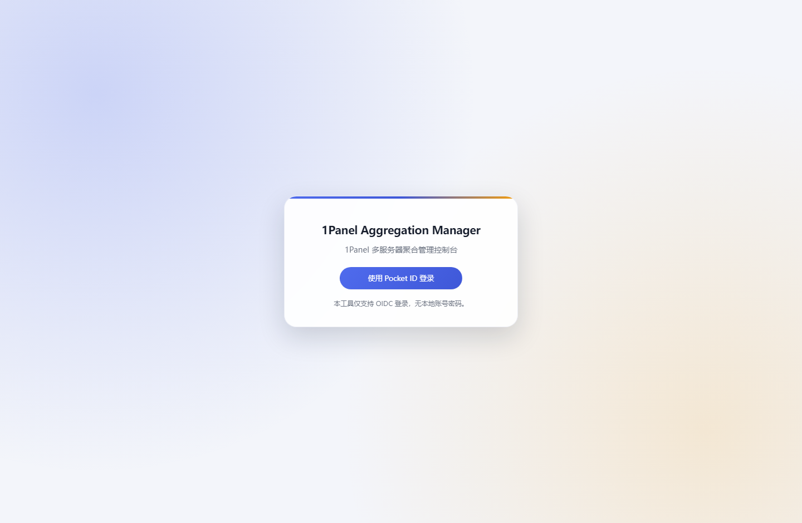

# 1Panel Aggregation Manager（原名 PanelFleet）

> 面向多台 1Panel v2 服务器的聚合管理控制台：一个界面完成跨节点监控、应用商店、容器、网站、数据库、计划任务、日志、终端与面板升级。

本项目由 AI 辅助开发（DeepSeek），作者为 WindyCloudCute。代码按“尽力而为”提供，**不保证生产环境可用**，请先在测试节点验证后再用于生产；为降低攻击面，本项目仅支持 OIDC 登录，不提供本地账号密码登录。

- **版本**：v0.0.1（2026-11-17）
- **技术栈**：.NET 10 / ASP.NET Core Minimal API + Blazor Server / EF Core + SQLite / OpenID Connect（Pocket ID 等）
- **形态**：单进程 Web 应用，浏览器访问；每个被管节点通过 1Panel API Key 接入（HMAC-SHA256 签名，请求不落库明文）

> 说明：仓库内的解决方案、程序集与命名空间沿用历史标识 `PanelFleet`（`PanelFleet.slnx`、`PanelFleet.*`）；产品对外名称为 **1Panel Aggregation Manager**。

---

## 功能一览

| 模块 | 能力 |
|---|---|
| 聚合总览 | 全部节点在线状态、CPU/内存/磁盘/负载/网络、资源计数；30s 自动刷新、增量渲染、节点故障降级标注 |
| 节点管理 | 新增/编辑/删除节点、连接测试、能力探测、健康巡检；API Key 用 DPAPI 加密存储，仅显示掩码 |
| 应用商店 | 商店搜索/分类/详情；安装、卸载、升级、参数修改；「已安装」与「可升级」独立页签；跨节点批量升级（逐节点逐应用、失败停止、Critical 强确认） |
| 容器管理 | 容器列表/详情/启停重启/暂停/删除、资源统计、日志（全屏、跟随、实时刷新）、容器 exec 终端抽屉；Compose 项目查看/新建/编辑/重建/删除 |
| 网站管理 | 建站向导（先选节点并预检 OpenResty/PHP 等依赖）、启停、基础信息编辑、域名增删改、SSL 申请/部署/关闭、反向代理增删改与启停、详情抽屉 |
| 数据库管理 | MySQL/MariaDB、PostgreSQL、MongoDB、Redis 实例与库/用户/权限；建库、改备注、用户与授权、Redis 配置；远程实例只读状态提示 |
| 计划任务 | 新建（先选节点）、编辑、启停、立即执行、执行记录；常用周期与 cron 互转 |
| 系统日志 | 面板操作/登录日志、系统日志、容器日志、网站日志；按节点与类型筛选，容器/网站日志按资源选择 |
| 面板更新 | 版本检查与更新说明（Markdown 渲染）、单节点升级、批量升级（≥2 节点 Critical 输入确认、逐节点顺序、任一失败即停、无自动回滚） |
| 终端 | 主机 Web 终端与容器 exec；WebSocket 桥接、空闲超时、会话审计（不记录按键内容） |
| 设置 | PanelFleet 设置（刷新间隔、审计保留等）与 1Panel 面板设置（只读概览 + 白名单安全字段修改，密码/API Key 走强确认与审计） |
| 审计 | 所有写操作记录操作者、节点、动作、参数键、结果与耗时；批次汇总 |

**统一的写操作安全模型**：预览（含目标与风险等级）→ 强确认（一次性 token，120s 有效、绑定操作者）→ 逐节点顺序执行（单节点锁、失败停止、无自动重试）→ 审计。危险操作（删除、1Panel 升级、SSL 部署等）为 High/Critical，需要输入确认文本。

## 技术架构

```
Blazor Server 页面 / REST API
        │
Application 层：模块服务 + 写操作内核（预览/确认/执行/审计）+ 并发扇出与缓存
        │
Client 层：1Panel v2 API 客户端（HMAC 签名、信封解析、错误映射、限流）
        │
Infrastructure：EF Core SQLite、DataProtection（DPAPI）、健康巡检、刷新宿主
```

- 解决方案：`PanelFleet.slnx`（`Domain` / `Client` / `Application` / `Infrastructure` / `Web` + 单元、契约、集成测试）
- 1Panel 适配版本：**v2.3.x**（API 根为 `/api/v2`，需在 1Panel「设置 → API 接口」启用并生成 API Key）
- 浏览器端无外部 CDN 依赖（图标为内联 SVG，xterm 资源本地打包）

## 快速开始

### 0. 获取代码

```powershell
git clone https://git.windycloud.cn:3000/WindyMadman/1panel-aggregation-manager.git
cd 1panel-aggregation-manager
```

发布/稳定版本在 `main` 分支（标签 `v0.0.1`），开发提交在 `dev` 分支。

> 注意：本仓库采用 **SHA-256 对象格式**（由远端服务端启用），克隆需要 Git **2.29+**；若提示 `the receiving end does not support this repository's hash algorithm`，请升级 Git 后重试。

界面预览（登录页）：



### 1. 环境要求

- .NET 10 SDK（建议 10.0.404+；仓库含 `global.json`）
- 一台可访问的 1Panel **v2.3.x** 节点，已启用 API 接口并生成 API Key
- 一个 OIDC 提供方（如 Pocket ID），用于唯一登录方式（无本地账号密码）
- Windows 10/11 或 Windows Server（当前主要验证平台；Linux 可运行，DataProtection 密钥保护需另行配置）

### 2. 配置

仓库内的 `src/PanelFleet.Web/appsettings.json` 是安全默认值（密钥字段为空）；`src/PanelFleet.Web/appsettings.example.json` 是带注释的完整模板，可复制后按需修改：

```powershell
Copy-Item src/PanelFleet.Web/appsettings.example.json appsettings.local.json -ErrorAction SilentlyContinue
```

**不要把真实密钥写进受版本控制的文件并提交**。推荐用环境变量覆盖（格式 `Section__Key`）：

| 环境变量 | 说明 | 示例 |
|---|---|---|
| `Oidc__Authority` | OIDC 发现地址 | `https://auth.example.com` |
| `Oidc__ClientId` | OIDC 客户端 ID | `your-client-id` |
| `Oidc__ClientSecret` | OIDC 客户端密钥 | 通过密钥管理系统/环境变量注入 |
| `Oidc__RequireHttpsMetadata` | 是否要求 HTTPS 元数据 | `true` |
| `Oidc__AdminRoles__0` | 管理员角色（groups 声明） | `panel-admins` |
| `Auth__AllowedEmails__0` | 允许登录的邮箱（可选） | `admin@example.com` |
| `PanelFleet__Listen__Url` | 监听地址 | `http://127.0.0.1:5188` |
| `PanelFleet__DataDirectory` | 数据目录（SQLite、密钥、日志） | `D:\PanelFleet\data` |
| `PanelFleet__ForwardedHeaders__Enabled` | 反向代理场景开启 | `true` |
| `Terminal__Enabled` | 是否启用 Web 终端 | `true` / `false` |

OIDC 回调地址：`http(s)://<host>:5188/sso/OIDC/Callback`，登出回调：`/sso/OIDC/SignedOut`。若通过反向代理发布，请同时配置外部回调地址与 `Oidc__RedirectUri`，并开启 `ForwardedHeaders`。

### 3. 发布与运行

```powershell
dotnet publish src/PanelFleet.Web/PanelFleet.Web.csproj -c Release -o publish
cd publish
$env:PanelFleet__DataDirectory = "D:\PanelFleet\data"
$env:PanelFleet__Listen__Url   = "http://127.0.0.1:5188"
$env:Oidc__Authority           = "https://auth.example.com"
$env:Oidc__ClientId            = "<client-id>"
$env:Oidc__ClientSecret        = "<client-secret>"
$env:Oidc__RequireHttpsMetadata = "true"
./PanelFleet.Web.exe
```

访问 `http://127.0.0.1:5188` → 使用 Pocket ID 登录 → 「节点管理」添加节点：

1. **名称**：任意显示名
2. **地址**：只填 1Panel **API 根地址**，如 `http://198.51.100.10:1000`；不要带安全入口（如 `/myentrance`），API 固定为 `/api/v2`
3. **API Key**：1Panel「设置 → API 接口」生成的 Key
4. **安全入口**（可选）：仅用于「在 1Panel 中打开」跳转，不参与 API 调用
5. **TLS 策略**：按节点证书情况选择（校验/忽略）
6. 保存后点「测试连接」，通过即可在总览看到数据

> 当前版本未内置 Windows 服务托管；可用任务计划程序或 NSSM 包装为服务运行。数据目录首次启动自动创建数据库与 DataProtection 密钥。

### 4. 登录与权限

- 仅 OIDC 登录；角色从 `groups` 声明读取，默认 `AdminRoles` 中的用户具备写权限，其余已认证用户只读（可用 `Oidc__ReadOnlyRoles` 细化）
- 未授权账号会看到「没有访问权限」页面
- 所有写操作都记录审计，可在「审计」页面查看

## 使用说明（按页面）

- **总览**：全部节点指标卡与资源计数；节点失败时显示降级原因，不阻塞其它节点
- **应用商店**：默认「商店」页签搜索安装；「已安装」查看参数/卸载；「可升级」汇总所有节点可升级应用，支持勾选批量升级（升级前可勾选备份/拉取镜像）
- **容器管理**：左侧节点树 → 容器/Compose 分组；行内启停、详情抽屉、日志面板（全屏/跟随/实时）、终端抽屉（Esc 关闭）
- **网站管理**：左侧节点树 → 分组 → 网站；新建网站走向导（节点 → 预检 → 类型/域名 → 应用/运行时 → 确认）；详情抽屉内管理域名、SSL、反向代理
- **数据库管理**：节点 → 引擎 → 实例 → 库；支持建库、备注、用户与授权；远程实例的监控状态为 1Panel 能力限制
- **计划任务**：新建时先选节点；支持启用/禁用/立即执行/查看记录
- **系统日志**：选择节点与日志类型；容器/网站日志需再选具体资源
- **面板更新**：先「检查更新」；单节点升级为 High，批量升级需输入确认文本，按节点顺序执行，失败即停（无自动回滚，请预留维护窗口）
- **终端**：选择节点（可再选容器）后连接；空闲 30 分钟断开；操作计入审计
- **设置**：PanelFleet 区可改刷新间隔、审计保留等（部分需重启生效）；1Panel 区只读展示版本/端口/安全入口等，安全字段修改走写操作内核

## 数据与安全

- **数据目录**：默认 `C:\ProgramData\PanelFleet`，包含 `panel.db`（节点、审计、设置）、`keys/`（DataProtection 密钥）、日志。迁移机器时请一并迁移并保证 DPAPI 可解密（同一用户/机器）。
- **节点 API Key**：使用 DataProtection（DPAPI）加密后入库，接口只返回掩码；日志与审计不记录明文。
- **OIDC ClientSecret**：只从环境变量/密钥存储读取，模板中为占位符。
- **仓库**：`data/`、`publish/`、`appsettings.Local.json`、`secrets/`、`tools/` 已在 `.gitignore` 中排除；配置模板见 [`src/PanelFleet.Web/appsettings.example.json`](src/PanelFleet.Web/appsettings.example.json)。
- **部署建议**：前置 HTTPS 反向代理并开启 `ForwardedHeaders`；限制来源 IP；为 1Panel API Key 设置最小权限并定期轮换；不需要终端时设 `Terminal__Enabled=false`。

## 开发

```powershell
dotnet build PanelFleet.slnx -c Release
dotnet test  PanelFleet.slnx -c Release
```

- 测试基线（v0.0.1）：**770 项通过**（单元 515 / 契约 88 / 集成 167），构建 0 warning / 0 error
- 目录：`src/PanelFleet.Web`（宿主 + 页面 + 端点）、`src/PanelFleet.Application`（业务与写操作内核）、`src/PanelFleet.Client`（1Panel API 客户端）、`src/PanelFleet.Infrastructure`（数据库/密钥/巡检）、`tests/*`
- 契约测试使用内置假 1Panel 面板，不依赖真实节点；集成测试覆盖认证、SSE/WS、写操作全链路

## 文档

| 文档 | 内容 |
|---|---|
| [docs/00-需求与范围.md](docs/00-需求与范围.md) | 目标、范围、非目标、验收 |
| [docs/01-架构设计.md](docs/01-架构设计.md) | 架构、1Panel 接入契约、安全、部署 |
| [docs/02-工作约束.md](docs/02-工作约束.md) | 阶段门禁、编码规范、Git 流程 |
| [docs/03-阶段计划.md](docs/03-阶段计划.md) | P0–P13 阶段与交付记录 |
| [docs/08-功能扩展路线图.md](docs/08-功能扩展路线图.md) | 各管理模块设计取向与安全模型 |
| [docs/09-P5-写操作内核详细设计.md](docs/09-P5-写操作内核详细设计.md) | 写操作内核（预览/确认/执行/审计） |
| [docs/18-UI重构与树形导航计划.md](docs/18-UI重构与树形导航计划.md) | 设计系统、树形导航、动效约束 |
| [docs/19-遗留问题修复与增强计划.md](docs/19-遗留问题修复与增强计划.md) | 反馈修复记录与最终门禁 |
| [docs/research/](docs/research/) | 1Panel v2.3.2 真实接口探测与路由依据 |

## 已知限制

- 真实节点上的写操作未做破坏性验收（仅在测试面板与只读接口上验证）；首次使用请先在测试节点试用
- 建站/SSL/应用安装等为 1Panel 异步任务：提交成功不等于立即可用，需在任务进度或面板中确认
- 1Panel 批量升级无官方批量接口，本工具按节点/应用顺序执行，失败即停且**不自动回滚**
- 跨节点聚合列表有单节点上限（默认 200/节点），超出会提示截断
- 远程数据库实例（非本地/应用安装）不支持状态监控（1Panel 限制）
- Windows 服务托管、单文件发布、告警通知等交付加固项尚未包含在本版本（见路线图 P13）

## 许可证与版权

本项目采用 **AGPL-3.0 + 商业授权** 双重许可：

- **开源使用（免费）**：遵循 [GNU Affero General Public License v3.0](LICENSE)。你可以自由使用、修改、分发，但**修改后的版本必须以同一许可证开源**；如果把它作为网络服务提供给他人使用，也必须向使用者提供对应完整源代码（AGPL 第 13 条）。
- **商业授权（付费）**：如需闭源集成、商业部署，或希望在不承担 AGPL 开源义务的前提下使用，请先联系作者获取商业授权（GitHub: [@WindyCloudCute](https://github.com/WindyCloudCute)）。

Copyright (c) 2026 WindyCloudCute

> - 本项目为个人开源项目，与 1Panel 官方（杭州飞致云信息科技有限公司 / FIT2CLOUD）无任何关联，也不代表其认可；1Panel 名称与商标归其权利人所有。
> - 本项目代码由 AI 辅助生成，作者已尽力审查，但不对适销性、特定用途适用性作任何担保；使用风险由使用者自行承担。
> - 如果你计划将本项目或其衍生作品用于商业目的，请务必先通过上述方式确认授权范围，避免侵权。

## 版本

- **v0.0.1**（2026-11-17）：首个聚合版本。历史开发提交已整理为单一提交，分支 `main` / `dev`，标签 `v0.0.1`。
- 详细变更见 [CHANGELOG.md](CHANGELOG.md)。
